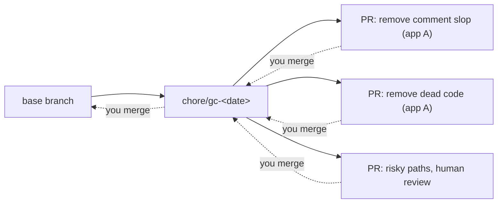

# Garbage collector

[](https://github.com/stablyai/orca)
[](https://github.com/mariano-aguero/orca-bots/commits/main/garbage-collector)
[](#how-a-run-works)
[](#install)
[](#settings)
[](../LICENSE)

An Orca bot that, on a schedule, removes comments that carry nothing and code and tests proven obsolete from a repo. It opens small PRs against an integration branch for each run, so a person reviews every removal and decides when it reaches the base branch. It never merges.

## How a run works



1. Picks the scope: what changed on the base branch since the last cleanup, plus the one app with the most comments that nobody cleaned in 90 days.
2. Classifies every comment, and proves any code or test it removes is unused.
3. Runs lint, typecheck, test and build. A PR whose checks fail is never opened.
4. Opens up to six PRs against the run's integration branch, and files an issue for every workaround it found.
5. Reports what it opened, what it left out and why.

## What it removes and what it keeps

| Kind | Action |
|---|---|
| Tautology: restates the code | Delete |
| Stale: no longer matches the code | Delete |
| Process marker: "Flow 2b", "step 3.5", task numbers | Delete |
| Outdated fact in a useful comment | Correct it when the code proves the value, else list it as a follow-up |
| Excuse: justifies a workaround or hack | Delete, and file an issue to fix the workaround |
| Constraint, quirk or invariant the code does not show | Keep |
| TODO and FIXME | Keep |
| Code with no references, outside any public API or wiring | Delete, with the proof in the PR |
| Tests of removed code, duplicates, or tests that assert nothing | Delete |

Code that moves money, holds keys or migrates data (`risky`) always gets its own PR for a human review.

## Files

- `SOUL.md`: who the bot is, its settings, what it reports and what it may never do.
- `skills/cleanup/SKILL.md`: the procedure. Scope, comment classification, dead code proof, PR split, verification.
- `examples/automation.txt`: an automation prompt with every setting.

## Install

Create a bot in Orca named `Garbage collector`, then from this folder:

```sh
BOT=$(dirname "$(grep -l '"name": "Garbage collector"' ~/.orca/bots/*/bot.json)")
cp "$BOT/SOUL.md" "$BOT/SOUL.md.bak"
cp SOUL.md "$BOT/SOUL.md"
mkdir -p "$BOT/.claude/skills/cleanup"
cp skills/cleanup/SKILL.md "$BOT/.claude/skills/cleanup/"
```

Then add one automation per repo. Copy `examples/automation.txt`, fill in your repo, and run:

```sh
orca automations create --bot "Garbage collector" --name "Cleanup your-repo" \
  --trigger "0 9 1,15 * *" --runs-in new --results-to chat \
  --prompt "$(cat automation.txt)"
```

Add `--model <id>` to pin the model, and `--disabled` to create it without scheduling runs yet.

Try it first with a dry run: send the bot the same prompt with "Do not push, open PRs or file issues; report what you would do." It does the whole cleanup in a local worktree and leaves it for you to inspect.

## Settings

| Setting | Meaning | Default |
|---|---|---|
| `repo` | GitHub `owner/name` and its Orca repo id | required |
| `base` | branch the cleanup starts from | the repo's default branch |
| `risky` | globs that always get a separate PR | `.github/risky-paths`, or none |
| `issues` | `github` or `linear:<team key>` | `github` |
| `max_prs` | most PRs per run | 6 |

## License

[MIT](../LICENSE)
